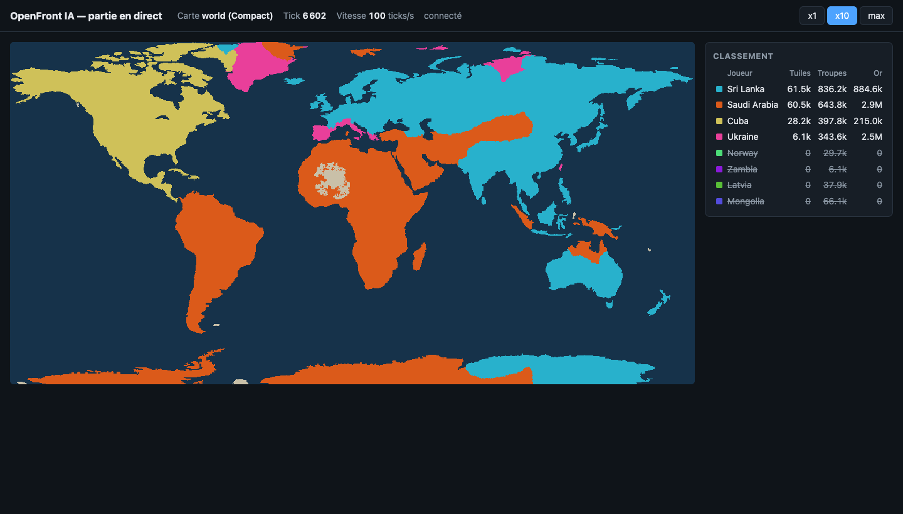

# openfront-ai

IA entraînée pour jouer et gagner à [OpenFront](https://openfront.io).

Ce dépôt contient pour l'instant le **squelette de l'environnement
d'entraînement** : le vrai moteur du jeu tourne sans interface dans un
processus Node, un agent Python le pilote par un socket local, et une page web
affiche la partie en direct.



## Organisation

| Dossier | Rôle |
|---|---|
| `openfront/` | Sous-module [OpenFrontIO](https://github.com/openfrontio/OpenFrontIO), figé sur `d1f2362`. **Ne jamais le modifier.** |
| `env/` | Serveur d'environnement en TypeScript (Node 24, lancé avec `tsx`). Il importe le moteur directement depuis `openfront/packages/*/src`. |
| `agent/` | Client Python (≥ 3.11) : classe `OpenFrontEnv` et script de démo. |
| `viewer/` | Page « partie en direct », servie par le serveur Node. |
| `scripts/` | Installation. |

## Installation

Prérequis : Node 24, npm 12 (exigés par OpenFrontIO), Python ≥ 3.11, git.

```bash
git clone --recurse-submodules https://github.com/FabLrc/openfront-ai.git
cd openfront-ai
./scripts/setup.sh
```

Le script initialise le sous-module, installe ses dépendances
(`npm run inst`), celles de `env/`, et crée le venv `agent/.venv`.

Si Node 24 ou npm 12 ne sont pas les versions par défaut, indiquez leur dossier :

```bash
NODE_BIN=/opt/homebrew/opt/node@24/bin NPM_BIN=~/openfront-bench/tools/node_modules/.bin ./scripts/setup.sh
```

(Les mêmes dossiers doivent être en tête du `PATH` pour les commandes `npm`/`npx` ci-dessous.)

## Utilisation

1. Lancer le serveur (socket `127.0.0.1:5555` et page `http://localhost:8080/live`) :

   ```bash
   cd env && npm start
   ```

2. Dans un autre terminal, jouer une partie FFA Compact à 8 Nations jusqu'à la fin :

   ```bash
   agent/.venv/bin/python agent/run_demo.py --seed demo
   ```

3. Ouvrir <http://localhost:8080/live> pour suivre la partie. Les boutons
   **x1** (temps réel, 10 ticks/s), **x10** et **max** règlent la vitesse de
   simulation ; par défaut le serveur va au maximum.

Autres commandes, depuis `env/` :

```bash
npx tsx src/selfplay.ts --seed demo   # partie complète sans agent ni serveur
npm test                              # tests vitest (déterminisme, protocole)
npm run typecheck                     # tsc --noEmit
```

## API de l'environnement

En Python :

```python
from openfront_ai import OpenFrontEnv

with OpenFrontEnv() as env:
    state = env.reset(map="world", size="Compact", nations=8, difficulty="Medium", seed="demo")
    while not state["done"]:
        state = env.step(10)
    print(state["winner"])
```

- `reset(...)` crée une partie (la phase de spawn est déjà jouée) ; `size` vaut
  `Compact` ou `Normal`, `difficulty` `Easy`, `Medium`, `Hard` ou `Impossible`.
  La graine détermine entièrement la partie.
- `step(n_ticks=10)` avance de `n_ticks` (moins si la partie se termine).

L'état renvoyé :

```json
{
  "tick": 1202, "inSpawnPhase": false, "alivePlayers": 8,
  "players": [{"id": 1, "name": "Cuba", "type": "nation", "alive": true,
               "tiles": 5021, "troops": 41230, "gold": 120400}],
  "winner": null, "done": false, "hash": 3444929393649712
}
```

`hash` est le dernier hash d'état publié par le moteur : deux parties de même
configuration et même graine ont le même vainqueur et le même hash.

### Protocole

Socket TCP sur `127.0.0.1:5555`, une partie par connexion. Chaque message est
un entier 32 bits big-endian (longueur) suivi d'un JSON UTF-8 :

- `{"cmd": "reset", "config": {"map": "world", "size": "Compact", "nations": 8, "difficulty": "Medium", "seed": "demo"}}`
- `{"cmd": "step", "ticks": 10}`
- `{"cmd": "close"}`

Réponse : `{"ok": true, "state": {...}}` ou `{"ok": false, "error": "..."}`.

La page `/live` reçoit par WebSocket (`/ws`), environ 5 fois par seconde, le
propriétaire de chaque tuile d'une carte sous-échantillonnée (au plus 1000
pixels de côté, `Uint16Array` compressé en deflate) et la liste des joueurs.
Elle affiche la dernière partie lancée.

## Performances

Sur un Mac 10 cœurs, une partie World Compact à 8 Nations se termine en
environ 13 500 ticks, soit 4 à 5 s (environ 3 000 ticks/s, client Python compris).
