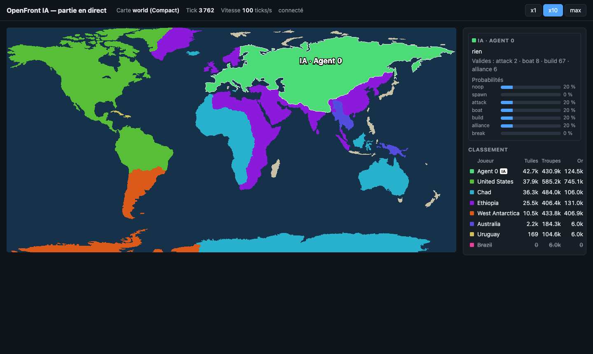
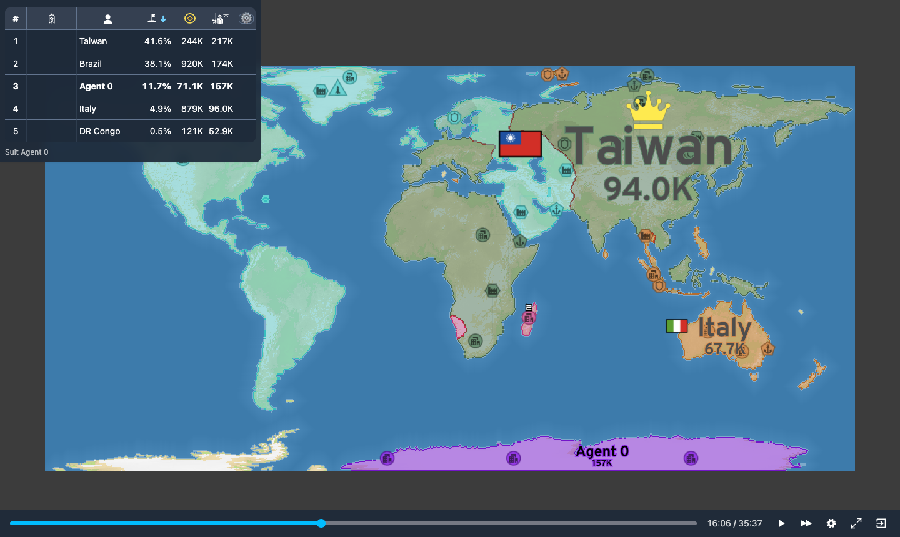
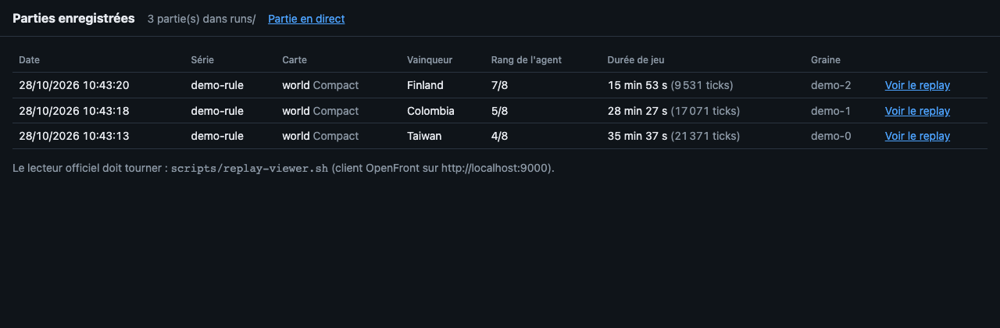

# openfront-ai

IA entraînée pour jouer et gagner à [OpenFront](https://openfront.io).

Ce dépôt contient pour l'instant le **squelette de l'environnement
d'entraînement** : le vrai moteur du jeu tourne sans interface dans un
processus Node, un agent Python le pilote par un socket local, et une page web
affiche la partie en direct.



## Organisation

| Dossier | Rôle |
|---|---|
| `openfront/` | Sous-module [OpenFrontIO](https://github.com/openfrontio/OpenFrontIO), figé sur `d1f2362`. **Ne jamais le modifier.** |
| `env/` | Serveur d'environnement en TypeScript (Node 24, lancé avec `tsx`). Il importe le moteur directement depuis `openfront/packages/*/src`. |
| `agent/` | Client Python (≥ 3.11) : classe `OpenFrontEnv` et script de démo. |
| `viewer/` | Page « partie en direct », servie par le serveur Node. |
| `scripts/` | Installation, ouverture d'un replay dans le lecteur officiel. |
| `runs/` | Parties enregistrées (non versionné). |

## Installation

Prérequis : Node 24, npm 12 (exigés par OpenFrontIO), Python ≥ 3.11, git.

```bash
git clone --recurse-submodules https://github.com/FabLrc/openfront-ai.git
cd openfront-ai
./scripts/setup.sh
```

Le script initialise le sous-module, installe ses dépendances
(`npm run inst`), celles de `env/`, et crée le venv `agent/.venv`.

Si Node 24 ou npm 12 ne sont pas les versions par défaut, indiquez leur dossier :

```bash
NODE_BIN=/opt/homebrew/opt/node@24/bin NPM_BIN=~/openfront-bench/tools/node_modules/.bin ./scripts/setup.sh
```

(Les mêmes dossiers doivent être en tête du `PATH` pour les commandes `npm`/`npx` ci-dessous.)

## Utilisation

1. Lancer le serveur (socket `127.0.0.1:5555`, pages `http://localhost:8080/live` et
   `/games`, API des replays sur `http://localhost:8787`) :

   ```bash
   cd env && npm start
   ```

2. Dans un autre terminal, jouer une partie FFA Compact jusqu'à la fin :

   ```bash
   agent/.venv/bin/python agent/run_demo.py --seed demo               # 8 Nations, sans agent
   agent/.venv/bin/python agent/run_demo.py --agent rule --seed demo  # l'agent à règles contre 7 Nations
   ```

3. Ouvrir <http://localhost:8080/live> pour suivre la partie. Les boutons
   **x1** (temps réel, 10 ticks/s), **x10** et **max** règlent la vitesse de
   simulation ; par défaut le serveur va au maximum. Les territoires des agents
   sont entourés de blanc et étiquetés « IA » ; un panneau montre leur dernière
   action (acceptée ou non par le moteur), le nombre d'actions valides par type
   et les probabilités si l'agent les envoie.

4. Évaluer les agents de référence (aléatoire et à règles), en enregistrant
   les parties (voir plus bas pour les revoir) :

   ```bash
   agent/.venv/bin/python agent/evaluate.py --games 10 --agent both --record essai
   ```

Autres commandes :

```bash
cd env && npx tsx src/selfplay.ts --seed demo     # partie complète sans agent ni serveur
cd env && npm test                                # tests vitest
cd env && npm run typecheck                       # tsc --noEmit
agent/.venv/bin/python -m unittest discover -s agent/tests   # dont le test d'API PettingZoo (serveur lancé)
cd env && npx tsx src/bench.ts --agents 1 --policy rule   # débit et coût par phase
```

## Environnement multi-agents (PettingZoo)

`OpenFrontEnv` suit l'API `ParallelEnv` de PettingZoo :

```python
from openfront_ai import OpenFrontEnv
from openfront_ai.agents import RuleAgent

env = OpenFrontEnv(agents=1, nations=7, difficulty="Medium")
policy = RuleAgent(seed=0)
obs, infos = env.reset(seed="demo")
while env.agents:
    actions = {a: policy.act(obs[a]) for a in env.agents}
    obs, rewards, terminations, truncations, infos = env.step(actions)
env.close()
```

Chaque siège d'agent est un joueur `Human` de la partie, comme un vrai client :
ses actions deviennent des intentions placées dans le `Turn` du tick suivant.
Un pas joue `ticks_per_step` ticks (10 par défaut). Le premier pas a lieu
pendant la phase de spawn : l'agent choisit sa tuile de départ parmi K+1
candidats valides (sinon un candidat est tiré au hasard), puis la phase de
spawn se termine.

### Observation

| Champ | Type | Contenu |
|---|---|---|
| `spatial` | uint8 [13, 64, 128] | grille sous-échantillonnée (paramétrable) : moi, alliés, ennemis, terres neutres, eau, front (tuiles adverses au contact de ma frontière), retombées, puis une couche par structure (ville, port, usine, poste de défense, silo, SAM : 255 = à moi, 128 = à un autre) |
| `players` | float32 [17, 16] | ligne 0 = terres neutres, puis les K=16 joueurs les plus pertinents (voisins d'abord, puis les plus gros) : part des terres, troupes, or, troupes relatives, relation, allié, frontière commune, voisin (y compris par la côte), attaques reçues/envoyées, demande d'alliance, Nation/Human |
| `scalars` | float32 [14] | troupes, max de troupes, ratio, or, part des terres, tick, seuil de victoire, part des joueurs vivants, phase de spawn, bateaux, villes, attaques en cours… |
| `spawn` | float32 [17, 3] | candidats de spawn (valide, x, y) pendant la phase de spawn |
| `masks` | dict uint8 | `type` [7], `target` [7, 17], `cell` [7, 512], `amount` [4], `unit` [6], `unit_cell` [6, 512] — masques conditionnels (la cible et la case dépendent du type) ; volontairement pas nommés `action_mask`, que PettingZoo et Gymnasium lisent comme un masque à plat par dimension |

Les noms exacts des canaux et des colonnes sont dans `env.spec_info` après `reset`.

### Action

`MultiDiscrete([7, 17, 512, 4, 6])` = `[type, cible, case, quantité, unité]` :

- `type` : rien, spawn, attaque, bateau, construction, alliance (demander, ou
  accepter si l'autre a déjà demandé), rupture d'alliance ;
- `cible` : ligne de la table des joueurs (0 = terres neutres), ou candidat de spawn ;
- `case` : case de la grille d'actions (32×16 par défaut), pour le bateau et la construction ;
- `quantité` : 10, 25, 50 ou 75 % des troupes (attaque, bateau) ;
- `unité` : ville, port, usine, poste de défense, silo à missiles, SAM.

Pour une construction, la tuile est la tuile possédée la plus centrale de la
case (la côte possédée la plus centrale pour un port) ; le moteur place
ensuite la structure comme pour un joueur. Pour un bateau, la cible est la
côte non possédée la plus centrale de la case.

Les masques reprennent les contrôles des exécutions du moteur : frontière
commune et cible attaquable (pas d'alliance, pas d'immunité) pour l'attaque,
or suffisant et emplacement valide pour la construction, côte atteignable par
l'eau et nombre de bateaux pour le bateau, `canSendAllianceRequest` pour
l'alliance. Une action masquée est remplacée par « rien » (`info["invalid"]`).
`info["accepted"]` indique si le moteur a réellement exécuté l'action. Le
moteur juge une intention un tick après l'observation : il reste de rares
refus (moins de 0,5 %, sur les tests) quand un front, une tuile ou un trajet
par l'eau disparaît entre-temps. Pour
limiter le coût, seules les 8 cases côtières les plus proches sont testées
pour les bateaux (paramètre `boatCandidates` ; chaque test coûte ~0,07 ms).

### Récompense

- à chaque pas : `shaping` × variation de la part des terres (`shaping=1` par défaut, 0 pour la désactiver) ;
- à la fin pour l'agent (mort, fin ou troncature de la partie) : +1 en cas de
  victoire, sinon `-1 + (n - rang) / (n - 1)` (de -1 pour le dernier à presque 0
  pour le deuxième). Les vivants sont classés par tuiles, les morts du plus
  tardif au plus précoce. `info` contient alors `rank`, `players` et `won`.

### Protocole

Socket TCP sur `127.0.0.1:5555`, une partie par connexion. Chaque trame :
longueur totale (u32 big-endian), longueur de l'en-tête (u32), en-tête JSON,
puis les tableaux binaires little-endian alignés sur 8 octets, décrits dans
`__buffers` (nom, type, forme, position). Les observations et masques ne
passent donc pas par JSON.

- `{"cmd": "reset", "config": {"map": "world", "size": "Compact", "nations": 7, "agents": 1, "difficulty": "Medium", "seed": "demo", "obsWidth": 128, "obsHeight": 64, "actionWidth": 32, "actionHeight": 16, "k": 16, "shaping": 1, "maxTicks": 0}}`
- `{"cmd": "step", "ticks": 10, "actions": {"agent_0": [2, 0, 0, 1, 0]}, "annotations": {"agent_0": {"probs": {...}}}}`
- `{"cmd": "close"}`

Réponse : `{"ok": true, "state", "agents", "rewards", "terminations",
"truncations", "infos"}` (plus `spec` au reset) et les tableaux
`agent_0/spatial`, `agent_0/mask_type`… ; ou `{"ok": false, "error": "..."}`.
Avec `agents: 0`, la phase de spawn est jouée au reset et `step` sans action
fait simplement avancer la partie (c'est ce qu'utilise `run_demo.py` sans `--agent`).

`state.hash` est le dernier hash d'état publié par le moteur : même
configuration, même graine et mêmes actions donnent le même hash.

La page `/live` reçoit par WebSocket (`/ws`), environ 5 fois par seconde, le
propriétaire de chaque tuile d'une carte sous-échantillonnée (au plus 1000
pixels de côté, `Uint16Array` compressé en deflate), la liste des joueurs et
l'état des sièges d'agents. Elle affiche la dernière partie lancée.

## Enregistrement des parties et replays



Chaque partie peut être enregistrée au format officiel d'OpenFront
(`GameRecord`, comme les archives du serveur) : configuration, joueurs, tous
les Turns avec les intentions des agents (les Nations sont recréées par le
moteur) et les hashes d'état publiés tous les 10 ticks. Le commit
d'OpenFrontIO (`d1f2362`) y est inscrit.

```bash
# 20 parties de l'agent à règles, enregistrées dans runs/regles/
agent/.venv/bin/python agent/evaluate.py --games 20 --agent rule --record regles
# une partie sur 5 seulement, jouées jusqu'au vainqueur après la mort de l'agent
agent/.venv/bin/python agent/evaluate.py --games 100 --record regles --record-every 5 --record-to-end
```

- Fichiers : `runs/<série>/games/<gameID>.json.gz` (10 à 30 Ko par partie) et
  `runs/<série>/index.jsonl` (date, carte, graine, vainqueur, rang de l'agent,
  durée). En Python : `OpenFrontEnv(record="serie", record_every=N, record_to_end=True)`.
- L'identifiant de partie (8 à 10 caractères alphanumériques, exigés par le
  lecteur) vient de la graine : la graine elle-même si elle convient, sinon
  les 10 premiers caractères de son SHA-1. Il initialise les tirages du
  moteur, donc deux graines différentes donnent deux parties différentes.
- Un épisode s'arrête à la mort de l'agent : sans `--record-to-end`, le record
  s'arrête là (« partie non finie » dans l'index).
- Rejeu headless (mêmes hashes, même vainqueur) :

  ```bash
  cd env && npx tsx src/replay.ts ../runs/regles/games/<gameID>.json.gz
  ```

### Lecteur officiel

```bash
scripts/replay-viewer.sh <gameID>   # sans identifiant : la liste des parties
```

Le script lance au besoin le serveur d'environnement et le client OpenFront
en mode développement (vite, `http://localhost:9000`), puis ouvre
`http://localhost:9000/#replay-viewer=<gameID>`. Le sous-module n'est pas
modifié : en développement, le client cherche les records sur
`http://localhost:8787/game/<id>` (sans `API_DOMAIN`), et c'est le serveur
d'environnement qui y répond avec `runs/`. Les autres appels du client à l'API
(actualités, cosmétiques, connexion) reçoivent un 404 sans gêner le lecteur.

La page <http://localhost:8080/games> liste les parties enregistrées (date,
série, carte, vainqueur, rang de l'agent, durée) avec un lien « Voir le replay ».



### Longs calculs

Le Mac peut se mettre en veille pendant une longue série de parties. Pour
l'en empêcher le temps d'une commande :

```bash
caffeinate -i agent/.venv/bin/python agent/evaluate.py --games 200 --record longue --record-every 10
```

Mieux vaut découper les longues mesures en plusieurs séries courtes (une
série par commande, chacune dans son dossier `runs/`).

## Agents de référence

20 parties FFA World Compact, 1 siège contre 7 Nations Medium (`evaluate.py --games 20`) :

| Agent | Victoires | Rang moyen | Durée de vie moyenne |
|---|---|---|---|
| aléatoire (dans les masques) | 0 % | 7,80 / 8 | 2 200 ticks |
| à règles (terres neutres, voisin le plus faible, villes) | 0 % | 5,45 / 8 | 8 200 ticks |

Aucun ne gagne encore : c'est la référence que l'apprentissage devra battre.

## Performances

Mac 10 cœurs. Le moteur seul joue une partie World Compact à 8 Nations
(~13 500 ticks) à environ 6 400 ticks/s.

Avec des sièges d'agents (pas de 10 ticks, `src/bench.ts`, sans socket) :

| Configuration | Pas/s | Ticks/s | Coût par pas |
|---|---|---|---|
| 1 agent + 7 Nations | ~250 | ~2 500–3 000 | simulation 1,5 ms, masques 0,6–1,6 ms, comptage de la carte 0,9 ms, observation 0,2 ms |
| 8 agents, sans Nation | ~70 | ~700 | simulation 1,7 ms, masques 10,6 ms (dont bateaux 8 ms), observation 1,5 ms |

Depuis Python (socket, sérialisation, politique), compter environ 100 pas/s
pour 1 agent. Le poste le plus cher est le masque des bateaux (recherches de
chemin sur l'eau, ~0,1 ms par case testée) : `boatCandidates: 4` donne ~90 pas/s
à 8 agents.
